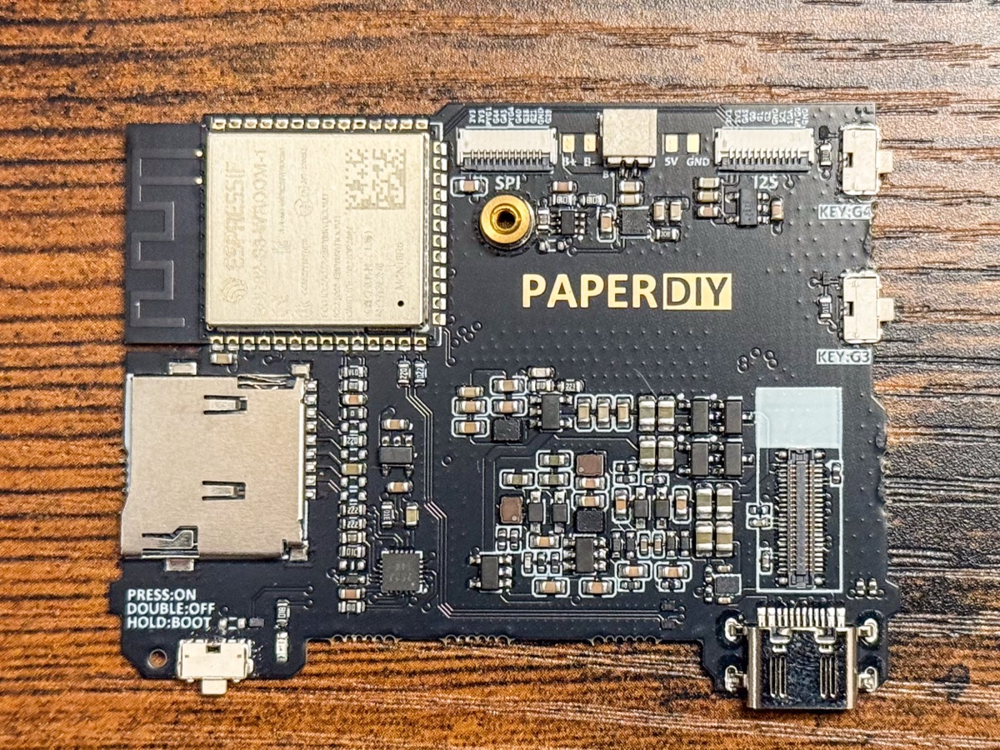

# M5Stack PaperDIY Arduino Examples

Arduino sketches for the [M5Stack PaperDIY](https://docs.m5stack.com/en/arduino/paperdiy/program) (ESP32-S3, 4.7" e-paper, two buttons, microSD, PM1 power chip).



Most sketches come straight from the official M5Stack
[PaperDIY Arduino program docs](https://docs.m5stack.com/en/arduino/paperdiy/program), with small tweaks along the way. `EpubReader` and `FastEPD` come from elsewhere (see below).

## Examples

| Sketch | What it does | Status |
| --- | --- | --- |
| [Button](Button) | Shows BtnA / BtnB presses on screen | Works |
| [Display](Display) | Basic M5GFX drawing and a border test | Works |
| [TextLogScroll](TextLogScroll) | Scrolling text log via M5GFX | Works |
| [microSD](microSD) | Reads `PaperDIY_01.png` / `PaperDIY_02.png` from the SD card and shows them | Works |
| [M5PM1](M5PM1) | Talks to the PM1 power-management chip (battery, power) | Works |
| [FactoryTest](FactoryTest) | Port of the M5Paper factory test: checklist, refresh-mode compare, gray ramp, Life game | Works |
| [PaperDIYUserDemo](PaperDIYUserDemo) | Port of the ESP-IDF user demo: battery, Wi-Fi scan, TF card speed test | Works |
| [EpubReader](EpubReader) | EPUB reader, port of [atomic14/diy-esp32-epub-reader](https://github.com/atomic14/diy-esp32-epub-reader). See its [README](EpubReader/README.md) | Works |
| [EpdFastCounter](EpdFastCounter) | Counter on the M5GFX `epd_fast` mode, reference for the Rust `epdpi` FastMono example | Works |
| [EpdQualityRamp](EpdQualityRamp) | 16-level gray ramp on the M5GFX `epd_quality` mode, reference for the Rust `epdpi` M5Quality example | Works |
| [FastEPD/animated_smiles](FastEPD/animated_smiles) | Animation with [FastEPD](https://github.com/bitbank2/FastEPD) | **Does not work** (see below) |

## Known issue: FastEPD examples

The FastEPD examples **do not work right now**. The current FastEPD release has no definition for the PaperDIY panel, so `initPanel()` / `setPanelSize()` can't drive this display. The sketch is kept in the repo for reference and will be revisited when FastEPD adds support for the panel.

Use M5Unified / M5GFX (as in all the other sketches) instead.

## Hardware notes

Panel: E Ink **ED047TC1**, 4.7", 540×960, 16 gray levels, 8-bit parallel interface
([datasheet](https://m5stack-doc.oss-cn-shenzhen.aliyuncs.com/517/C139_ED047TC1_datasheet.pdf)).
Board design: [PaperDIY schematic](https://m5stack-doc.oss-cn-shenzhen.aliyuncs.com/1288/K159-B_PaperDIY_sche.pdf).

**Panel connector:** 44 pins, 0.4 mm pitch. The panel has a Panasonic header
[AXE644224](https://industry.panasonic.com/global/en/products/control/connector/base-fpc/number/axe644224);
the board has the mating socket
[AXE544127](https://industry.panasonic.com/global/en/products/control/connector/base-fpc/number/axe544127) (`EPD1` in the schematic).

**ESP32-S3 pins to the panel** (as configured in [M5GFX](https://github.com/m5stack/M5GFX)):

| Panel signal | GPIO |
| --- | --- |
| D0–D7 | 6, 14, 7, 12, 9, 11, 8, 10 |
| XCL (clock) | 16 |
| XLE (latch) | 15 |
| XSTL / SPH (source start) | 13 |
| XOE (output enable) | 45 |
| CKV (gate clock) | 18 |
| SPV (gate start) | 17 |
| Panel power (boost converter) | 46, plus M5PM1 GPIO2 over I2C (SDA 41, SCL 42) |

### Libraries that do not drive this panel

- **GxEPD2** and **[GxEPD_HD](https://github.com/ZinggJM/GxEPD_HD)** cover SPI panels and Good Display / Waveshare HD panels. Neither has an ED047TC1 class. Online examples that use `GxEPD2_470_T75` with PaperDIY pins are wrong.
- **[LilyGo-EPD47](https://github.com/Xinyuan-LilyGO/LilyGo-EPD47)** drives the same panel, but on different GPIOs and with a shift register for the control signals. It would need a pin remap and the M5PM1 power-up sequence.
- **FastEPD**: see above.

## Setup

Board: `m5stack:esp32:m5stack_paperdiy`, PSRAM: **OPI PSRAM**.

Install from the Library Manager:

- **M5Unified**
- **M5GFX**
- **M5PM1** (only for the `M5PM1` sketch)

SD, SPI and WiFi come with the ESP32 core.

## Build and upload

```
arduino-cli compile --fqbn m5stack:esp32:m5stack_paperdiy:PSRAM=opi Button
arduino-cli upload -p <port> --fqbn m5stack:esp32:m5stack_paperdiy:PSRAM=opi Button
```

Replace `Button` with any sketch folder.

## microSD sketch

Copy `PaperDIY_01.png` and `PaperDIY_02.png` from the repo root to the root of a FAT32 microSD card before running [microSD](microSD).

## License

Sketches derived from M5Stack docs and third-party projects keep their original licenses. See each project's source for details.
